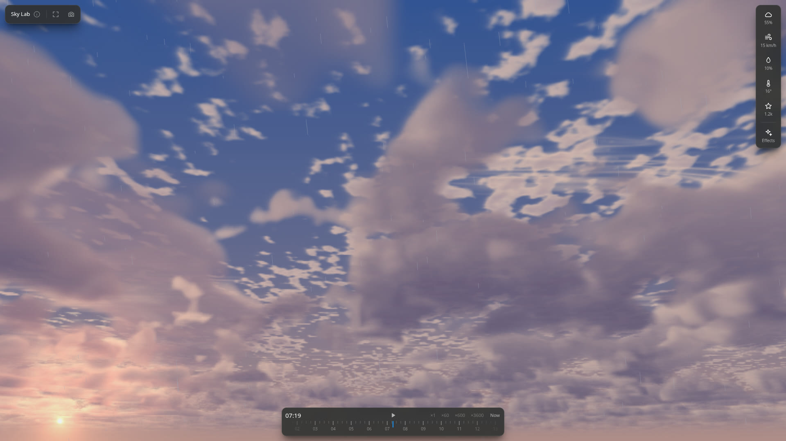

# Sky Lab

A sky simulated frame by frame in the browser. No photos, no video: the colour
of the air, the clouds, the sun, the moon, the stars and the rain all come from
the settings you choose.



## Features

- **Time of day**: follows the device clock, or scrub the hours by hand and play
  them back at several speeds.
- **Weather**: cloud cover, wind, rain and temperature. The cloud types follow
  the weather (cirrus, altocumulus, cumulus up to cumulonimbus, stratus
  overcast), and rain turns to snow in the cold.
- **Moon and stars**: pick the moon phase, set how many stars are visible.
- **Sunlight**: sun disc, glare, aureole and crepuscular rays through the gaps
  in the clouds.
- **Effects**: send a plane, a flock of birds, a shooting star or a hot-air
  balloon across the sky.
- **Photo and sharing**: take the sky as an image, or share a link that reopens
  the same sky (`?time=18.5&clouds=40&rain=0…`).
- **Immersive mode** hides the interface. Every action has a keyboard shortcut
  (press `I` for the list).

## How it works

The scene is built from a fixed pinhole camera facing south, in world units, so
the sun, the moon and the effects keep a real perspective.

- **WebGL2** fragment shaders render the clouds (several layers, lit by the sun
  or the moon) and the direct sunlight. They draw to an offscreen canvas.
- **Canvas 2D** composites the frame: sky gradient by sun elevation, stars, moon
  (shaded from NASA's LRO albedo map), the WebGL layer, rain and effects.
- **React** drives the interface and the settings only. The sky renders outside
  React, in its own animation loop (`src/sky/`).

## Stack

React 19, TypeScript, Vite, Tailwind CSS v4, Bun.

## Getting started

```sh
bun install
bun run dev      # dev server
bun run build    # type-check and production build
```

## Deploy

The site is served as static assets by a Cloudflare Worker (`wrangler.jsonc`).

```sh
bunx wrangler login   # once
bun run deploy        # build, then upload dist/
```

## Contributing

1. Fork the repo and create a branch from `main`.
2. Make your change. Keep `src/sky/` free of React code.
3. Check that it passes:
   ```sh
   bun run lint
   bun run format:check
   bun run build
   ```
4. Open a pull request that describes the change, with a screenshot when it
   changes what the sky looks like.

## License

[MIT](LICENSE)
